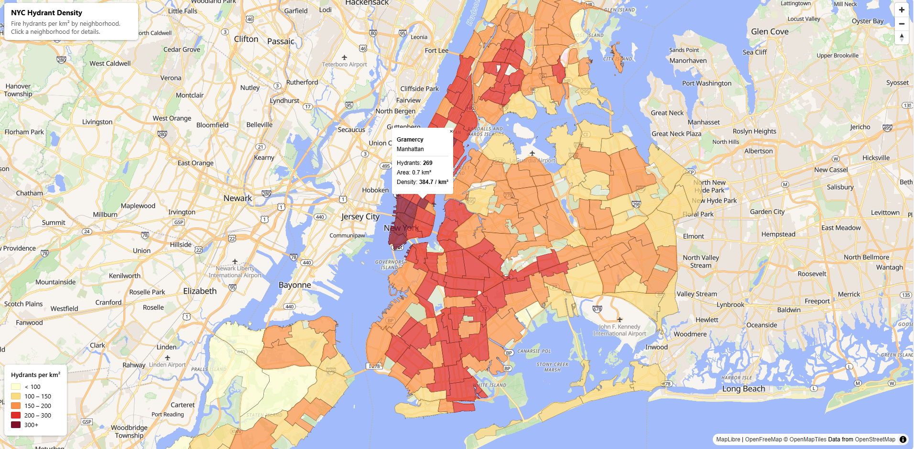
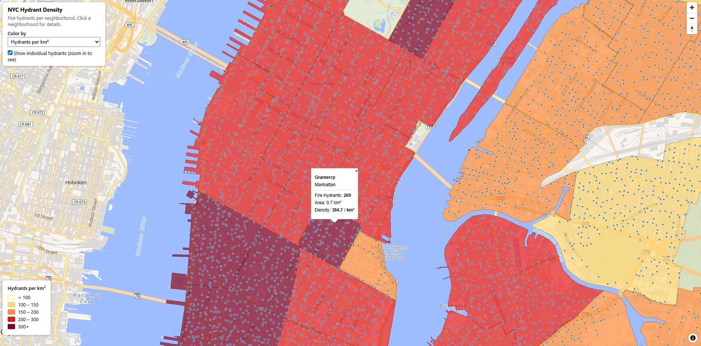

# NYC Hydrant Density Map

An interactive web map of fire hydrant density across New York City's residential neighborhoods, built with open data and open-source tools. It runs entirely in the browser from static files: no tile server, no build step.



**Live map:** https://burlesongis.github.io/nyc-hydrant-map/

## What it shows

Staten Island has the most hydrants, but Manhattan has the *densest* coverage. Raw counts favor big neighborhoods, so the map colors each of NYC's 197 residential neighborhoods by hydrants per square kilometer (Gramercy is highest at 384.7 per km²) and lets you switch to raw counts to see the difference.

## Features

- **Choropleth** of 197 residential neighborhoods, colored on a five-step yellow-to-red ramp
- **Metric dropdown:** switch between *Hydrants per km²* and *Hydrant count*; the map colors and the legend update together
- **Hydrant checkbox:** show or hide the individual hydrant points (zoom in to see them)
- **Hover** to outline a neighborhood, **click** for a popup with its name, borough, hydrant count, area and density



*Zoomed in with "Show individual hydrants" ticked: each blue dot is one hydrant, drawn over the neighborhood density colors.*

## How it's built

```
PostGIS (neighborhood analysis) → GeoJSON → tippecanoe → PMTiles → MapLibre GL JS
```

| Piece | What it does |
|---|---|
| PostGIS (Docker) | Counts hydrants per neighborhood with a spatial join (`ST_Contains`) and computes density; selects hydrants inside residential neighborhoods (`ntatype = '0'`) |
| tippecanoe v2.82.0 | Converts GeoJSON into vector tiles |
| PMTiles | Packs each tileset into a single file; the browser fetches only the tiles it needs using HTTP range requests |
| MapLibre GL JS 5.21 + pmtiles 4.4 | Renders the vector tiles and handles interaction (loaded from a CDN) |
| OpenFreeMap | Free, key-free OpenStreetMap-based basemap |

Two tile files power the map:

| File | Contents | Size |
|---|---|---|
| `neighborhood_density.pmtiles` | 197 neighborhood polygons with hydrant count, area and density | ~220 KB |
| `hydrants.pmtiles` | 108,121 hydrant points inside residential neighborhoods | ~2 MB |

## Run it locally

PMTiles needs a web server that supports HTTP range requests. Python's built-in `http.server` does not (it returns the whole file instead of the requested bytes, so the map layers fail to draw). Use `rangehttpserver`:

```bash
pip install rangehttpserver
python -m RangeHTTPServer 8080
```

Then open http://localhost:8080 and hard refresh (Ctrl+Shift+R) after any change.

## Rebuild the tiles (optional)

These steps need tippecanoe and, for the hydrant points, a PostGIS database loaded with the NYC datasets.

```bash
bash create_pmtiles.sh            # neighborhood polygons from the density GeoJSON
bash create_hydrant_pmtiles.sh    # hydrant points straight from PostGIS
```

`create_hydrant_pmtiles.sh` runs `residential_hydrants.sql` inside the PostGIS container, streams the result out as newline-delimited GeoJSON, and builds `hydrants.pmtiles` with `-l hydrants -Z10 -z14 --drop-densest-as-needed`.

## Design decisions

- **Density over counts.** Counts say Staten Island; density says Manhattan. The default view uses density, and the dropdown lets you compare.
- **Separate breakpoints per metric.** Counts range from 81 to 1,708, so they get their own color breaks (300 / 450 / 600 / 800). Reusing the density breaks would turn almost everything dark red. One `METRICS` settings object drives both the map colors and the legend, so they can't drift apart.
- **Residential neighborhoods only.** Parks, airports and cemeteries are excluded. 108,121 of 109,725 hydrants fall inside the residential neighborhoods.
- **Thinned points at low zoom.** Tippecanoe drops points at lower zooms by default, so zoomed-out views show a sample and the maximum zoom shows every hydrant.

## Challenges

| Problem | Cause | Fix |
|---|---|---|
| Polygons didn't render, basemap fine | Python's `http.server` ignores HTTP range requests, which PMTiles needs | Use `python -m RangeHTTPServer` |
| "API KEY REQUIRED" watermark over the basemap | The starter CARTO raster tiles now require a key | Switched to OpenFreeMap's key-free style |
| tippecanoe isn't available on Windows | It doesn't build natively | Installed in WSL2 Ubuntu; run via `wsl bash create_pmtiles.sh` |
| `column ... does not exist` in the SQL | The geometry column in my database is `geom`, not the lesson's `wkb_geometry` | Checked `geometry_columns` and updated the query |
| Docker not reachable from WSL | Docker Desktop's WSL integration was off for Ubuntu | Enabled Ubuntu under Settings > Resources > WSL Integration |

## Project structure

```
index.html                      the whole web map (MapLibre, no build step)
about.html                      project description, data sources and methodology
neighborhood_density.pmtiles    neighborhood polygons
hydrants.pmtiles                residential hydrant points
create_pmtiles.sh               GeoJSON -> neighborhood tiles
create_hydrant_pmtiles.sh       PostGIS -> hydrant tiles
residential_hydrants.sql        hydrants inside residential neighborhoods
images/                         screenshots
```

## Data and credits

- Fire hydrants: [NYC Open Data, Hydrants (NYCDEP)](https://data.cityofnewyork.us/Environment/Hydrants/5bgh-vtsn), snapshot downloaded September 2026
- Neighborhoods: NYC Open Data, 2020 Neighborhood Tabulation Areas (NTAs)
- Basemap: [OpenFreeMap](https://openfreemap.org), © [OpenMapTiles](https://openmaptiles.org), data from [OpenStreetMap](https://www.openstreetmap.org/copyright) contributors
- Tools: [MapLibre GL JS](https://maplibre.org), [PMTiles](https://github.com/protomaps/PMTiles), [tippecanoe](https://github.com/felt/tippecanoe), PostGIS

Built as part of Matt Forrest's Modern GIS Accelerator course by Dana Burleson.
